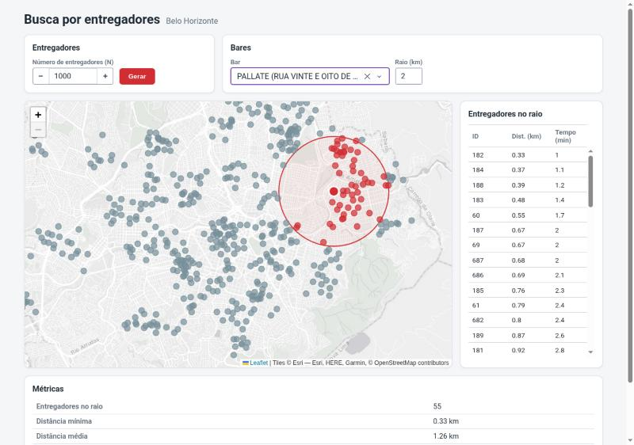
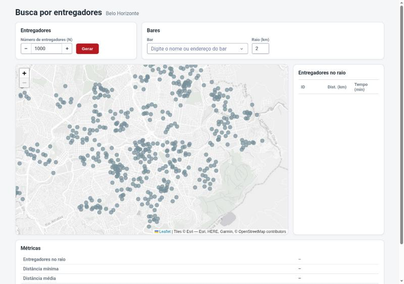
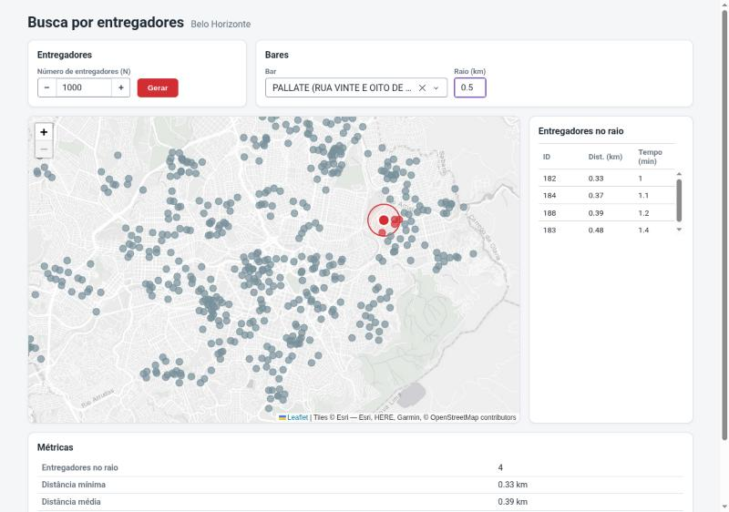
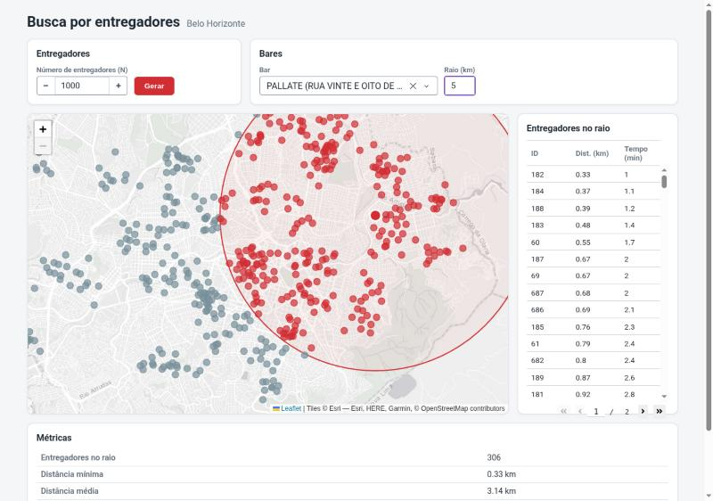
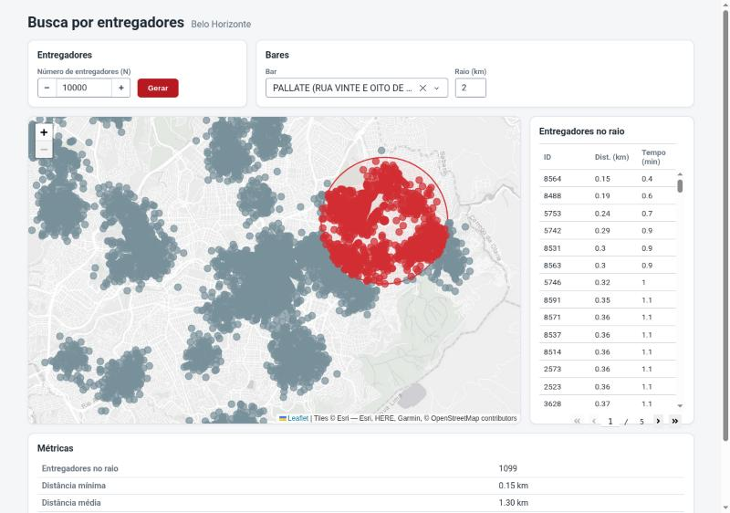

# Trabalho Prático 1 – Busca de Entregadores com Geohash e Trie

Sistema que mostra, em um mapa de Belo Horizonte, quais entregadores estão perto de um bar ou
restaurante escolhido. A busca usa um **Geohash**, que transforma uma coordenada geográfica em um texto, guardado numa **Trie compacta**.



---

## 1. Como executar

Requisito: Python 3.13

```bash
python3 -m venv .venv
.venv/bin/pip install -r requirements.txt
.venv/bin/python app.py
```

Depois abra **http://127.0.0.1:8050** no navegador.

Outros comandos:

```bash
.venv/bin/pytest                        # roda os testes
.venv/bin/python -m scripts.benchmark   # roda os experimentos
```

**Primeira execução:** o mapa de ruas de BH é baixado do OpenStreetMap, o que leva cerca de
1,5 minuto e é salvo em `cache/bh_drive.graphml`. Nas próximas vezes ele é lido do disco em
poucos segundos.

---

## 2. Como usar a interface

A tela tem quatro partes:

| Parte | Para que serve |
|---|---|
| **Entregadores** | Escolha quantos entregadores criar (N) e clique em **Gerar**. Cada clique apaga os entregadores anteriores e cria um conjunto novo. |
| **Bares** | Escolha um bar na lista. É possível digitar parte do nome **ou** do endereço. Ao lado fica o **raio de busca** em km de 0,1 a 20 km. |
| **Mapa e tabela lateral** | O mapa mostra os entregadores. A tabela ao lado lista os entregadores dentro do raio, com o ID, a distância e o tempo estimado até o bar. |
| **Métricas** | Resumo da busca: quantos foram encontrados, distâncias mínima e média, tempo médio de chegada, tempo da busca e tempo da geração. |

**Cores no mapa:**

- **Cinza:** entregador fora do raio.
- **Azul:** entregador dentro do raio.
- **Ponto vermelho com borda branca:** o bar escolhido.
- **Círculo vermelho:** o raio de busca.

---

## 3. Organização do projeto

```
app.py                      ponto de entrada cria o Dash, monta a tela e liga os eventos
src/
├── state.py                estado global do programa com dados, escolhas do usuário, e resultados
├── core/                   
│   ├── geohash.py          codificação Geohash, decodificação e vizinhas
│   └── trie.py             Trie compacta 
├── process/                
│   ├── search.py           distância, escolha da precisão, índice e busca por raio
│   ├── couriers.py         geração dos entregadores
│   └── streets.py          download e leitura da malha viária utilizando osmnx
└── interface/              
    ├── ui.py               componentes da tela 
    └── callbacks.py        funções callbacks de interação do usuário com a interface
assets/
├── style.css               estilos customizados para página
└── markers.js              componente simples para representar marcadores na tela
scripts/benchmark.py        experimentos de perfomance
tests/                      testes automatizados
data/bares.csv              base original de bares e restaurantes de BH
data/bares_geo.csv          base processada, com latitude e longitude
docs/img/                   prints usados no relatório
cache/                      arquivos obtidos localmente
```

---

## 4. O problema

Um aplicativo de entregas precisa responder rápido quais entregadores estão a até X km
de um determinado restaurante.

A forma mais simples com (**força bruta**) é calcular a distância do restaurante até cada
entregador. Ao fazer isso, o tempo cresce junto com o número de entregadores. Com 100 mil
entregadores, seriam 100 mil contas por consulta.

A solução mais eficiente parte de pegar só os entregadores da região
do restaurante, usando Geohash + Trie. Depois calculamos a distância exata só para esses
poucos candidatos.

---

## 5. Os dados

- `data/bares.csv`: Mais de 20.800 bares, restaurantes e lanchonetes de BH. Traz nome, endereço, bairro e tipo de atividade, mas não traz coordenadas geográficas.
- `data/bares_geo.csv`: A mesma base com a adição das colunas `latitude` e `longitude`. As coordenadas
  vieram do cruzamento com a base de Atividade Econômica da Prefeitura de BH, que tem a
  localização de cada estabelecimento.

Os bares são usados de duas formas: como pontos de busca escolhidos pelo usuário e como centros para gerar os entregadores.

---

## 6. Implementação

### 6.1 Geohash

O Geohash transforma uma coordenada com latitude, longitude em um texto curto, como `7h2y8jev` que representa o centro de BH, com 8 caracteres.
A propriedade importante para a aplicação é que pontos próximos costumam ter o começo do texto igual, ou seja, possuem o mesmo prefixo. Assim, o problema de achar quem está perto é convertido em achar quem possui o mesmo prefixo.

**O encode segue o seguinte procedimento:**

1. Os limites da localização começam com o mundo inteiro com longitude variando de -180 a 180 e latitude de -90 a 90.
2. Divide o intervalo da **longitude** ao meio. Se o ponto está na metade de cima, anota o
   bit `1`; se está na de baixo, anota `0`. O intervalo passa a ser só aquela metade.
3. Faz o mesmo com a **latitude**.
4. Repete, alternando longitude e latitude.
5. A cada 5 bits, forma-se um número de 0 a 31, que vira um caractere da base 32: `0123456789bcdefghjkmnpqrstuvwxyz`.

O resultado usa no máximo **8 caracteres**. Com essa precisão, o mapa de BH pode ser dividido em uma grade em que cada célula possui um 
tamanho no mundo real de 19 m × 36 m. 

- O **decode** faz o caminho inverso e devolve a caixa da célula, ou seja, os limites
  de latitude e longitude.
- A função **neighbors** devolve as 8 células vizinhas para o norte, sul, leste, oeste e
  diagonais. Para isso, pega o centro da célula, anda uma célula em cada direção e codifica
  de novo.

### 6.2 Trie compacta

Uma **Trie** é uma árvore em que cada caminho da raiz até um nó forma um prefixo. Todos os
textos que começam com `7h2y` ficam embaixo do mesmo nó. Então, para achar todo elemento que
começa com `7h2y`", basta descer até esse nó e pegar tudo o que está embaixo dele.


**Estrutura do nó** 

```python
class Node:
    label     # o pedaço de texto da aresta que chega neste nó 
    children  # primeiro caractere do filho -> nó filho
    values    # lista de entregadores cujo Geohash termina exatamente aqui
```

- **`children` é um dicionário** indexado pelo primeiro caractere. Como dois filhos nunca
  começam com o mesmo caractere, achar o filho certo custa O(1).
- **`values` é uma lista**, porque dois entregadores podem cair no mesmo Geohash de 8
  caracteres. Isso trata essa colisão.
- Cada entregador é guardado pela coordenada inteira e pelo ID, para depois calcular a
  distância exata.

**Inserir**

Desce pela árvore comparando o texto com o `label` de cada aresta:

- se não existe filho com aquele caractere, cria uma folha com o resto do texto.
- se o texto bate com a aresta só até a metade, **divide a aresta em duas**: cria um nó
  intermediário com a parte comum e pendura o resto embaixo dele.

**Buscar por prefixo**

1. Desce pela árvore consumindo o prefixo. O prefixo pode terminar **no meio** de uma aresta,
   e isso é tratado.
2. Ao chegar no nó certo, junta os entregadores de toda a subárvore, usando uma pilha.

Essa busca custa **O(m + k)**. Descer custa no máximo `m` comparações, onde `m` é o tamanho
do prefixo. Depois, a subárvore tem `k` entregadores. Como a árvore é compacta e todo nó
interno tem pelo menos 2 filhos, uma subárvore com `k` folhas tem no máximo cerca de `2k`
nós. 

### 6.3 Busca por raio 

A busca tem três passos:

- **Montar o índice.** Cada entregador é inserido na Trie com o seu
Geohash de 8 caracteres.

- **Escolher o tamanho do prefixo.** Escolhemos a maior precisão cuja célula seja pelo menos do tamanho do raio, tanto na altura quanto na largura.

- raio de 0,5 km → precisão 6;
- raio de 1 a 2 km → precisão 5;
- raio de 5 a 10 km → precisão 4;
- raio de 20 km → precisão 3.

A largura de uma célula em km diminui com a distancia ao Equador. O cálculo usa a
latitude mais distante do Equador que a célula pode alcançar, para não superestimar a largura.

- **Buscar nas células e filtrar.**

1. Calcula o Geohash do restaurante com a precisão escolhida.
2. Busca na Trie esse prefixo e os prefixos das 8 vizinhas. O resultado são os
   candidatos.
3. Para cada candidato, calcula a distância real pela fórmula de **haversine** para a distância
   sobre a superfície da Terra e fica só com quem está a até `r` km.
4. Ordena o resultado pela distância.

Para o **tempo de chegada**, assumimos uma velocidade média de **20 km/h** para moto em área urbana. O tempo é `distância ÷ 20 km/h`. É uma estimativa
simples em linha reta sem considerar o caminho pelas ruas.

### 6.4 Geração dos entregadores

São gerados N entregadores em quatro passos.

**1. Escolha dos centros** `k = mínimo(n / 10, 100)`, com pelo menos 1.

- Os entregadores devem ser divididos **igualmente** entre os
  bares. Mas são mais de 20.800 bares e com N = 1.000 não dá nem um entregador por bar. Então
  são sorteados alguns bares para serem os centros. A regra garante cerca de 10 entregadores por
  centro quando N é pequeno, e no máximo 100 centros, para os grupos não ficarem espalhados
  demais.

**2. Sorteio dos centros** Sorteia `k` bares diferentes.

**3. Distribuição normal** Cada centro recebe `n / k` entregadores. Quando a
conta não é exata, o resto vai um a um para os primeiros centros. Cada entregador é colocado
em `centro + desvio`, e o desvio vem de uma **distribuição normal** com desvio-padrão de
**300 m** em cada eixo.

- A distribuição normal deixa muitos entregadores bem perto do bar e cada vez menos
  à medida que se afasta. O valor de 300 m deixa os grupos visíveis no mapa sem que se misturem demais.
- Os cálculos são feitas em metros. O mapa de ruas é convertido para a projeção UTM para que signifique 300 metros de verdade.

**4. Correção para a rua mais próxima** Um ponto sorteado pode cair dentro de um prédio, de
um quarteirão fechado. Para corrigir isso é feito o seguinte procedimento.

1. O mapa de ruas de BH é baixado do OpenStreetMap com a biblioteca `osmnx`, só com as ruas
   por onde passam carros.
2. Para cada ponto, achamos o trecho de rua mais próximo.
3. O ponto é movido para o lugar mais próximo sobre a linha desse trecho.

O resultado é uma lista de `(latitude, longitude, id)`.

### 6.5 Estado global

Toda a informação do app fica num único objeto, `AppState`, criado uma vez no `app.py`. Ele
tem três grupos de campos:

| Grupo | Campos | Quem preenche |
|---|---|---|
| **Dados** | bares, mapa de ruas, entregadores, Trie | o carregamento e o botão Gerar |
| **Escolhas do usuário** | N, bar escolhido, raio | os campos da tela |
| **Resultados** | entregadores encontrados, tempo da busca, tempo da geração | a busca e a geração |

- Dessa forma a tela só lê o estado e mostra o que está lá. Os cálculos só leem e escrevem no
  estado. Assim a interface fica completamente desacoplada do processamento a ser realizado.

---

## 7. Complexidade

Se `p` é a precisão de no máximo 8, `N` o número de entregadores, `c` o número de candidatos
nas células e `m` o número de encontrados.

| Operação | Tempo |
|---|---|
| `encode` / `decode` de um Geohash | O(p) |
| `neighbors` | O(p) |
| Inserir na Trie | O(p) |
| Buscar um prefixo na Trie | O(p + k), sendo k os entregadores da subárvore |
| Montar o índice | O(N · p) |
| Busca por raio (9 prefixos + filtro + ordenação) | O(p + c + m log m) |
| Força bruta | O(N + m log m) |

**Memória da Trie:** O(N), porque uma Trie compacta com N chaves tem no máximo cerca de 2N nós.

---

## 8. Experimentos

### 8.1 Consultas na interface

Todas as consultas usam o bar **PALLATE** (Rua Vinte e Oito de Setembro, 606 – Esplanada).
O tempo de busca é o tempo da função `searchRadius`:

| # | N | Raio | Encontrados | Dist. mínima | Dist. média | Tempo médio de chegada | **Tempo de busca** |
|---|---|---|---|---|---|---|---|
| 1 | 1.000 | 2 km | 55 | 0,33 km | 1,26 km | 3,8 min | **0,895 ms** |
| 2 | 1.000 | 0,5 km | 4 | 0,33 km | 0,39 km | 1,2 min | **0,171 ms** |
| 3 | 1.000 | 5 km | 306 | 0,33 km | 3,14 km | 9,4 min | **1,417 ms** |
| 4 | 10.000 | 2 km | 1.099 | 0,15 km | 1,30 km | 3,9 min | **4,076 ms** |

Tempo de geração considerando a distribuição normal + correção para as ruas + montagem da Trie: **0,82 s**
com N = 1.000 e **1,05 s** com N = 10.000.

**Entregadores gerados (N = 1.000).** É possível ver os grupos em volta dos bares sorteados, com
mais entregadores no centro de cada grupo, e todos sobre as ruas:



**Consulta 1 – raio de 2 km (55 entregadores, 0,895 ms):**


**Consulta 2 – raio de 0,5 km (4 entregadores, 0,171 ms):**



**Consulta 3 – raio de 5 km (306 entregadores, 1,417 ms).**



**Consulta 4 – 10.000 entregadores, raio de 2 km (1.099 entregadores, 4,076 ms):**



### 8.2 Índice x força bruta

Para cada N, geramos os entregadores sobre o mapa real de BH e fizemos **100 consultas**,
centradas em bares sorteados. A tabela mostra a **média por consulta**. Em todas as 1.200
consultas, o índice devolveu **exatamente** o mesmo conjunto que a força bruta.

| N | Raio | Precisão | Candidatos (9 células) | Encontrados | Índice (ms) | Força bruta (ms) | Ganho |
|---|---|---|---|---|---|---|---|
| 1.000 | 0,5 km | 6 | 28 | 4 | 0,08 | 0,38 | 4,8× |
| 1.000 | 1 km | 5 | 481 | 15 | 0,31 | 0,40 | 1,3× |
| 1.000 | 2 km | 5 | 481 | 51 | 0,34 | 0,42 | 1,2× |
| 1.000 | 5 km | 4 | 1.000 | 259 | 0,58 | 0,42 | 0,7× |
| 10.000 | 0,5 km | 6 | 263 | 38 | 0,27 | 3,71 | **13,7×** |
| 10.000 | 1 km | 5 | 5.049 | 136 | 3,06 | 3,85 | 1,3× |
| 10.000 | 2 km | 5 | 5.049 | 499 | 2,94 | 3,91 | 1,3× |
| 10.000 | 5 km | 4 | 10.000 | 2.622 | 5,35 | 4,18 | 0,8× |
| 100.000 | 0,5 km | 6 | 3.008 | 531 | 1,94 | 38,87 | **20,0×** |
| 100.000 | 1 km | 5 | 48.793 | 1.683 | 29,98 | 40,04 | 1,3× |
| 100.000 | 2 km | 5 | 48.793 | 5.415 | 29,33 | 40,15 | 1,4× |
| 100.000 | 5 km | 4 | 100.000 | 26.498 | 67,35 | 46,85 | 0,7× |

Tempo para montar a Trie: **7 ms** (N = 1.000), **75 ms** (N = 10.000) e **822 ms**
(N = 100.000).

### 8.3 Análise dos resultados

- **Raios pequenos** Com raio de 0,5 km, a precisão 6 é suficiente. O
  bloco de 9 células tem cerca de 1,8 km × 3,4 km e contém aproximadamente 3% dos entregadores. O
  índice olha só esses e fica até 20 vezes mais rápido que a força bruta. Quanto maior o
  N, maior o ganho.
- **Raios médios** O tamanho das células do Geohash dá saltos
  de 32 vezes. A célula de precisão 6 já é menor que 1 km, então a busca
  precisa cair para a precisão 5, cujas células têm cerca de 4,9 km. O bloco 3×3 fica com
  ~15 km × 14 km, quase metade da cidade. Muitos candidatos são verificados à toa e o ganho
  fica em ~1,3×.
- **Raios grandes** A precisão 4 tem células de ~20 km × 37 km.
  O bloco 3×3 cobre a cidade inteira, então o índice olha **todos** os entregadores 
   e ainda paga o custo de percorrer a Trie. Fica cerca de 30% mais lento.
- **A concentração piora os casos médios.** Os entregadores ficam agrupados perto
  dos bares que se concentram na região central. As células do centro têm mais candidatos
  que a média.
- **A interface representa um gargalo** O que mais demora é desenhar os pontos no mapa, não a busca.

**Conclusão:** Geohash com Trie é muito eficiente quando a área de busca é pequena em relação à
área total, que é o caso típico do problema de encontrar entregadores perto de um ponto. Para raios que forçam uma
precisão baixa, o ganho desaparece por causa do tamanho fixo das células.

---

## 9. Bibliotecas usadas

As estruturas centrais Geohash e Trie e a busca não usam nenhuma biblioteca. As
bibliotecas abaixo foram usadas só para interface, mapas e leitura de dados:

| Biblioteca | Função |
|---|---|
| `dash`, `dash-leaflet` | Página interativa e mapa |
| `pandas` | Leitura do CSV dos bares |
| `osmnx`, `networkx` | Download e uso do mapa de ruas do OpenStreetMap |
| `geopandas`, `shapely`, `numpy` | Conversão para metros, sorteio da distribuição normal e projeção do ponto na rua |
| `pytest` | Testes |